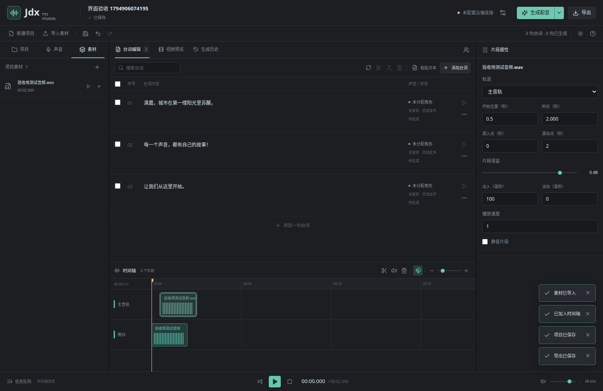

# Jdx TTS Studio

面向视频后期的中文桌面配音工作站。使用阿里云百炼远程语音模型，在本地管理项目、生成历史、时间轴、视频和导出文件。无需本地模型、CUDA 或 NVIDIA 显卡。

当前版本为 **0.1.2**，提供 Linux deb、AppImage 和源码包。0.1.2 改进声音查找与试听、默认连接和时间轴操作；Windows x64 NSIS 安装包已于 2026-11-18 构建，安装与卸载尚未验收。功能实现与实际测试状态分别记录在 [测试报告](docs/TEST_REPORT.md)。真实云端合成需要用户自己的百炼账户和 API Key。



## 开始使用

### 开发环境运行

需要 Node.js 22、pnpm、uv。以下指令会准备独立 Python 3.12 环境，并自动启动前后端：

```sh
uv sync --project backend --python 3.12 --locked
pnpm install --frozen-lockfile
pnpm dev
```

打开 `http://127.0.0.1:1420`。开发启动器负责启动后端、生成随机会话令牌以及退出清理，禁止把这个开发地址暴露到公网。浏览器开发模式的 API Key 仅存内存，退出后重新填写。

### 桌面运行与打包

```sh
pnpm desktop
```

Tauri 自动启动后端。桌面开发需要 Rust 和系统 WebView 开发依赖，详见 [桌面构建说明](docs/DESKTOP.md)。

Linux：

```sh
bash scripts/build-linux.sh
```

Windows：

```cmd
scripts\build-windows.cmd
```

Windows 的 Git Bash 或 MSYS2 也可执行：

```sh
sh scripts/build-windows.sh
```

必须分别在目标操作系统构建。安装版包含完整 Python 运行目录和 FFmpeg，最终用户无需安装开发工具或手动运行 FastAPI。

## 配音工作流程

1. 新建项目，在“云端连接”中填写名称、百炼服务根地址（Base URL）和 API Key，并设为默认连接。工作流无需另外选择业务地域或填写业务空间 ID。
2. 选择模型，在声音库搜索并试听兼容音色。官方静态样音会缓存到本地，试听不提交生成请求、不消耗合成额度；连接测试也只执行只读检查。
3. 粘贴台词，或导入 TXT、SRT、VTT。设置角色、情绪、表达指令、语速及停顿。
4. 生成当前句、选中句或全部台词。流式模式可边生成边试听；生成完成后音频立即保存到本地。
5. 在历史中试听、比较、选择旧版本或标记最佳版本。修改台词不会删除历史音频。
6. 在时间轴多选片段、跨轨移动、吸附对齐、裁剪、分割、静音和调整淡入淡出；可导入视频及字幕辅助对齐。当前尚不支持交叉淡化和可编辑淡化曲线。
7. 导出完整 WAV/MP3、逐句音频、CSV 时间码清单，或导出完整项目备份。

详细操作与限制见 [使用说明](docs/USER_GUIDE.md)。

声音库依据阿里云[官方音色列表](https://help.aliyun.com/zh/model-studio/qwen-audio-tts-voice-list)，整理为 157 个模型/音色条目、153 个唯一音色 ID；按模型、语言和声线筛选，并可收藏常用音色。时间轴交互参考了 [Premiere Pro 的片段吸附](https://helpx.adobe.com/premiere/desktop/edit-projects/change-clip-sequence/snap-clips.html) 与 [Audition 的多轨片段编辑](https://helpx.adobe.com/audition/desktop/mixing-multitrack-sessions/arranging-editing-multitrack-clips.html)、[淡化控制](https://helpx.adobe.com/audition/desktop/mixing-multitrack-sessions/clip-volume-matching-fading-mixing.html)。

## 技术与目录

- `src/`：React、TypeScript、可调整面板、TanStack Query、Zustand、Wavesurfer.js 工作台。
- `src-tauri/`：桌面生命周期、单实例、凭据库、原生保存对话框和后端进程树管理。
- `backend/jdx_backend/`：FastAPI、SQLAlchemy、SQLite 项目库、百炼协议、任务队列及 FFmpeg 音频处理。
- `backend/tests/`、`tests/ui/`：协议、数据安全、非破坏性处理、队列和浏览器工作流测试。
- `scripts/`：开发启动、OpenAPI 类型生成及各平台构建。
- `docs/`：接口约定、官方依据、开发记录和验证结果。

应用偏好和连接元数据保存在应用数据库中；每个项目有独立的 SQLite、原始素材、音频历史和导出目录。真实密钥不进入项目或备份。数据库迁移前保存备份。

项目列表中的删除操作将项目移入应用回收站，保留全部原始音频和历史版本，可从“项目回收站”恢复。生成、导出、导入期间不允许删除项目。详见 [项目生命周期说明](docs/PROJECT_LIFECYCLE.md)。

云端请求跟随系统/环境代理，兼容 `socks://`、`socks5://`、`socks5h://` 和 HTTP/HTTPS；本地服务始终直接连接。代理设置在启动应用时继承，修改后需重新启动；不需要为本地服务配置代理。

## 检查命令

```sh
pnpm typecheck
pnpm build
pnpm test
uv run --project backend pytest backend/tests -q
pnpm api:types
pnpm exec playwright test
```

界面端到端测试需要已运行的开发工作台，使用本地测试音频验证导入、渲染和导出；它不代替真实云端推理测试。OpenAPI 类型由后端契约生成，修改 API 后执行 `pnpm api:types`。

## 验证边界

云端能力依据 2026-11-17 核验的阿里云官方 API 实现。接口地址、音色兼容性和收费规则可能变化；自定义模型的高级能力默认不假定支持。网络中断后结果不确定的生成不会自动重试，避免重复收费。

测试报告明确区分代码实现、协议模拟验证、真实云端调用、原生构建和干净系统安装。没有凭据或目标系统时，不会把相应验证标为通过。
