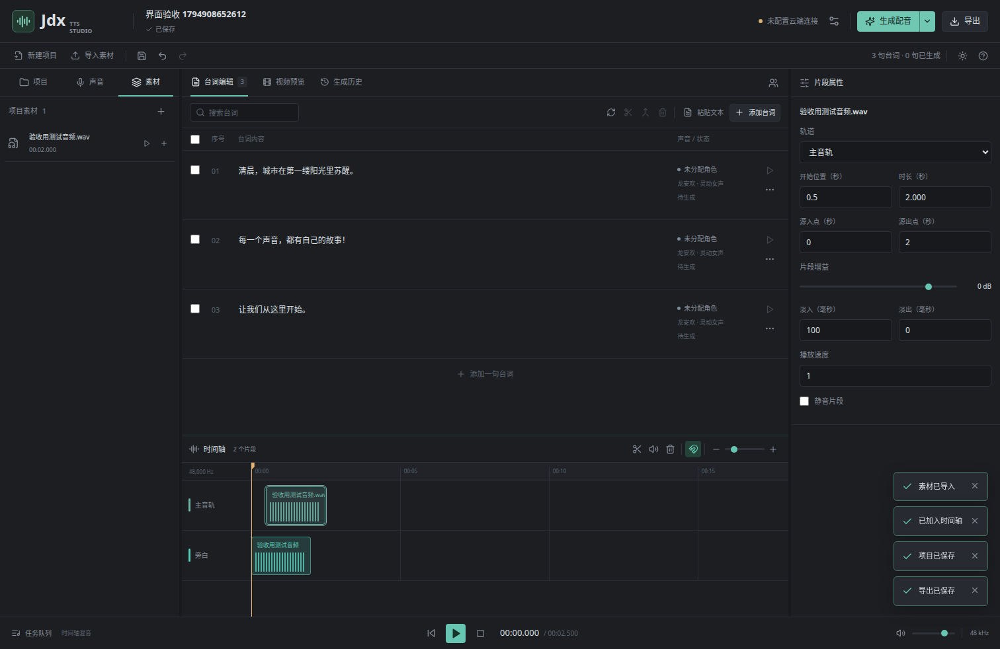

# 测试与交付记录

验证日期：2026-11-17。0.1.2 Linux 交付物已构建，并在 Ubuntu 26.04.1 x86_64 完成解包与启动检查。Windows 安装包和其他 Ubuntu 版本仍未验证。

## 0.1.2 声音库、连接和时间轴迭代

| 检查 | 结果 | 覆盖范围 |
| --- | --- | --- |
| 后端 pytest | **125 项通过** | 声音目录、默认连接、样音下载/缓存、安全访问和既有后端回归 |
| Vitest | **20 项通过** | 前端声音分组、搜索/筛选及时间轴编辑算法等 |
| OpenAPI 类型生成 | 通过 | 运行 `pnpm api:types` 后前后端契约一致 |
| TypeScript 类型检查 / React 生产构建 | 通过 | 迭代前端源码 |
| 官方静态样音 | **4 条通过** | Plus 中文、Flash 中文、英文、小语种；完成下载、解码和规范化，不调用合成接口 |
| Playwright | **7 项通过** | 工作台、连接、声音库试听/收藏/复制音色 ID、项目生命周期及时间轴；使用本地素材和预览替身，没有提交云端生成 |
| Rust 原生单测 | **8 项通过** | 会话令牌、启动握手、凭据清理、导出路径保护及子进程回收 |
| 真实百炼合成、声音克隆、声音设计 | 未验证 | 未配置有效账户，不产生付费请求 |
| Linux deb | **已构建，126,370,736 字节** | 解包后的桌面程序通过自动启动、动态端口、认证和退出回收检查；未安装到系统 |
| Linux AppImage | **已构建，212,953,592 字节** | 默认启动和 `--appimage-extract-and-run` 均通过同一桌面生命周期检查 |
| 源码 ZIP | **179 个文件** | 清单脚本验证源码、文档、测试、锁文件存在，并排除运行数据、音频、密钥文件、安装包和构建缓存 |

声音条目数、试听缓存和连接默认值细节见[声音库改进记录](VOICE_LIBRARY.md)；样音检查证据见 `docs/verification/official-preview-verification-0.1.2.json`。时间轴当前有多选、跨轨拖动、吸附、裁剪、分割、复制、静音、微调和线性淡入淡出；交叉淡化与自定义淡化曲线尚未实现。

0.1.2 桌面启动和冻结后端证据见 `docs/verification/*0.1.2.json`。构建在 Ubuntu 26.04.1 使用项目内解包的 GTK/WebKit 依赖完成；AppImage 由 linuxdeploy/AppImageTool 封装。deb 只解包运行，没有进行系统安装。Windows 与 Ubuntu 22.04/24.04 尚未构建或验证。

0.1.2 交付文件为 `release/Jdx-TTS-Studio-0.1.2-linux-amd64.deb`、`release/Jdx-TTS-Studio-0.1.2-linux-amd64.AppImage` 和 `release/Jdx-TTS-Studio-0.1.2-source.zip`。`release/SHA256SUMS-0.1.2` 与 `release/desktop-delivery-manifest-0.1.2.json` 保存校验和、文件清单及验证边界。

## 0.1.1 修复验证

本轮针对 `Unknown scheme for proxy URL URL('socks://127.0.0.1:7897')` 与项目管理缺失执行修复。使用本地协议测试服务及专用测试项目，未提交付费云端生成。

| 检查 | 结果 | 覆盖范围 |
| --- | --- | --- |
| 后端 pytest | **111 项通过** | 全套回归，13.94 秒；包含代理与项目生命周期新增场景 |
| Python 语法检查 | 通过 | 后端和 Python 脚本 |
| OpenAPI 前端类型生成 | 通过 | 回收站、删除和恢复契约与后端同步 |
| TypeScript 类型检查 / React 生产构建 | 通过 | 最终前端源码 |
| Vitest | **7 项通过** | 台词、采样位置、费用估算和并发编辑合并 |
| Playwright | **4 项通过** | 全套最终运行 18.5 秒；含原工作台 2 项与项目生命周期 2 项 |
| Rust 编译检查 / 原生测试 | 通过 / **8 项通过** | 0.1.1 桌面壳及进程、凭据、文件安全逻辑 |
| 冻结后端基础检查 | **7 项通过** | 独立运行、中文路径、握手、认证、音频导入、FFmpeg 导出、父管道断开退出 |
| 冻结后端代理检查 | **3 项通过** | 实际本地 SOCKS 握手、混合 HTTP/ALL_PROXY、WebSocket SOCKS5H；云端请求为 0 |
| 当前系统代理下外网只读检查 | 通过 | 用修复后的客户端访问阿里云官方文档返回 HTTP 200；没有使用 API Key |
| Linux deb / AppImage 构建 | 通过 | 0.1.1 最终前端和冻结后端；保留 0.1.0 旧产物 |
| deb 解包布局及 AppDir 后端 | 通过 | 两种布局分别执行音频导入/FFmpeg 导出及 3 项代理检查 |
| Linux 桌面窗口与进程生命周期 | 通过 | 中文数据路径、混合代理、自动启动、认证保护、正常关闭和后端回收 |
| AppImage 默认启动与解包启动 | 通过 | 最终 release 文件默认启动，以及 `--appimage-extract-and-run` 均完成窗口、后端和退出检查 |

新增验证覆盖：

- 兼容 `socks://` 别名；HTTP/HTTPS 与 ALL_PROXY 并存时按实际目标选用代理，未使用的无效代理不会阻止客户端启动。本地服务和 NO_PROXY 地址直接连接。
- HTTP 与 WebSocket 的 SOCKS 运行依赖已进入冻结运行目录；无效配置、代理认证和连接错误不会泄漏代理凭据。
- 项目重命名、取消删除、删除当前或其他项目、回收站恢复、重启持久化；删除和恢复前后导入 WAV 的字节完全一致。
- 删除前保存编辑；删除后清除当前项目选择；旧项目的迟到响应不会覆盖新项目。删除期间生成、导出、导入的并发保护与修订号冲突均有后端覆盖。
- 应用 SQLite v2 → v3 迁移及迁移备份；项目 SQLite 维持 v2。回收站中的项目无法通过旧媒体链接继续访问。
- TXT/SRT/VTT 新台词继承连接与默认模型/音色。连接表单有未保存字段或密钥时禁止测试并提示先保存，避免测试旧配置。

冻结后端代理检查由本地代理完成握手后主动拒绝上游连接，验证依赖、协议选择和错误反馈；这不等于已通过代理完成真实百炼合成。原始记录见 `docs/verification/*0.1.1.json`。

0.1.1 交付文件位于 `release/`：deb **126,325,920** 字节，AppImage **212,908,536** 字节，另附源码 ZIP。`SHA256SUMS-0.1.1` 记录三个交付文件的摘要；`desktop-delivery-manifest-0.1.1.json` 记录产物及证据索引。源码包含锁定依赖、构建脚本、测试与文档，排除运行数据、用户音频和会话凭据。安装包在当前 Ubuntu 26.04.1 主机验证；没有执行 deb 系统安装、Windows 安装或旧 Ubuntu 兼容性验收。

## 环境

- Ubuntu 26.04.1 LTS，Linux x86_64。
- Python 3.12.16 独立虚拟环境；Node.js 22.23.4，pnpm 12.18.0。
- Rust 1.100.0；本机缺少系统开发包，以项目内解包的开发依赖完成编译，未修改系统安装。
- 浏览器工作流使用本机 Google Chrome。
- 验收未使用有效百炼 API Key。云端合成、克隆、设计、取消均只完成协议验证，未完成真实付费账户验证。

## 0.1.0 已执行结果（历史）

| 检查 | 结果 | 覆盖范围 |
| --- | --- | --- |
| Python 语法检查 | 通过 | 后端及 Python 构建脚本 |
| 后端 pytest | **73 项通过** | 2026-11-17 最终运行，12.08 秒 |
| TypeScript 类型检查 / React 生产构建 | 通过 | 真实前端入口及生成 API 类型 |
| Vitest | **7 项通过** | 台词拆分、采样位置、费用估算、三方合并与冲突处理 |
| Playwright | **2 项通过** | 真实本地服务下的项目编辑/重载、素材导入、波形、时间轴处理、WAV 下载及连接设置 |
| Rust 原生单元测试 | **8 项通过** | 会话令牌、握手验证、导出路径/覆盖保护、子进程清理、凭据状态及不可用钥匙环 |
| Linux 原生构建 | 通过 | release 可执行文件、deb、AppImage |
| 冻结后端独立运行 | 通过 | 无虚拟环境依赖、中文数据路径、动态端口、认证、导入、FFmpeg 导出、父管道断开退出 |
| Linux 桌面启动 | 通过 | 真实显示环境启动打包程序，自动启动后端并通过健康检查，退出回收进程 |
| AppImage 运行 | 通过 | 最终 AppImage 在当前主机默认方式启动，后端健康检查和退出清理通过；另外验证 AppDir 内冻结后端的完整导入/导出链路 |
| Windows 专属原生模块编译 | 通过 | 使用 Windows GNU 目标检查 Credential Manager 与 Job Object 源码；不是完整 Windows 应用构建 |

pytest 有一条第三方 Starlette TestClient 对 httpx 的弃用提醒，不影响本次通过结果，后续升级测试依赖时处理。

## 原有能力回归覆盖

- 百炼 HTTP/WS 请求结构、音频块、协议顺序、服务端取消确认、最终累计用量、鉴权/限流/断线错误。
- 已提交但结果不确定的请求不会自动重试；重复生成提交去重；排队取消不调用服务；运行取消后不发布迟到音频。
- **500 句队列压力测试通过**：使用明确的测试替身代替云端合成和格式转换，验证并发为 2、500 个独立结果/版本以及自动排列不重叠。这不是 500 句真实云端生成测试。
- 500 句项目编辑、保存、重开；字幕时间码导入；旧版本保留；生成期间修改台词不被旧结果覆盖。
- 原始音频不被裁剪或混音操作改写；WAV 48kHz/24-bit；限制器延迟补偿和普通速度下的采样位置保持。
- 视频代理生成；拒绝播放列表和不允许的媒体协议；音频签名链接和 Range；过期或篡改签名被拒绝。
- 克隆参考录音大小/格式/时长、目标模型与连接绑定；设计试听音频规范化、签名链接和删除后失效。
- 备份包含最新 SQLite WAL 写入；恢复为新项目；恢复不误中断其他项目任务；拒绝路径穿越、恶意数据库结构、异常快照和内嵌密钥。
- 缺失素材重新连接保持稳定 ID，拒绝覆盖仍存在的原素材，验证新素材覆盖已有裁剪范围。
- 密钥不出现在 API 响应、项目数据库和导出包中；价格未知时不编造费用。

## 尚未验证与明确边界

| 项目 | 状态 / 原因 |
| --- | --- |
| 真实百炼合成、声音克隆、音色设计、流式取消效果 | 未验证：未使用有效账户执行付费验收；协议测试不能证明账户权限或声音质量 |
| 真实长文本、多角色、500 句连续云端生成 | 未验证：需要真实账户、配额及相应调用费用 |
| Windows 安装包构建、安装、卸载、运行和凭据库持久化 | 未验证：当前是 Linux 环境；提供了 Windows 原生构建脚本 |
| Ubuntu 22.04/24.04 干净环境安装 | 未验证：当前产物在 Ubuntu 26.04 构建；正式面向较旧发行版发布时必须在最低支持环境重建 |
| `.deb` 系统安装与卸载 | 未执行系统安装：无免密管理员权限；最终 deb 解包目录下的实际布局启动及后端回收已通过 |
| 原生保存对话框完整人工交互、可用系统钥匙环的跨重启持久化 | 未完成交互验收；原生相关逻辑和无钥匙环回退已有自动测试 |
| 自定义模型高级能力自动验证与提升 | 暂未实现；同协议自定义模型支持基础合成，高级参数默认限制，已核验的内置型号可正常配置 |
| 精确逐字情绪或百分之百声音还原 | 不作保证；情绪/重音为生成建议，非本地采样级编辑 |

## 复现命令

```sh
uv run --project backend python -m compileall -q backend/jdx_backend scripts
uv run --project backend pytest backend/tests -q
pnpm api:types
pnpm typecheck
pnpm build
pnpm test
# 另一终端已运行 pnpm dev 后执行：
pnpm exec playwright test
# 冻结后端生成后执行：
uv run --project backend python scripts/smoke-runtime.py src-tauri/resources/backend/jdx-backend
uv run --project backend python scripts/smoke-proxy-runtime.py src-tauri/resources/backend/jdx-backend
```

Rust 构建需先安装目标平台开发依赖，详见 [桌面构建说明](DESKTOP.md)。测试不应在包含用户真实云端密钥的生产数据目录运行。

0.1.0 历史安装产物：deb 126,258,660 字节；AppImage 212,838,904 字节。交付目录中的 `SHA256SUMS` 和 `desktop-delivery-manifest.json` 保留首轮产物摘要。相应运行检查原始 JSON 记录保存在 `docs/verification/`。

## 界面验收截图

截图中的音频是明确命名的验收测试音频，台词未提交云端生成，不代表已验证云端效果。


